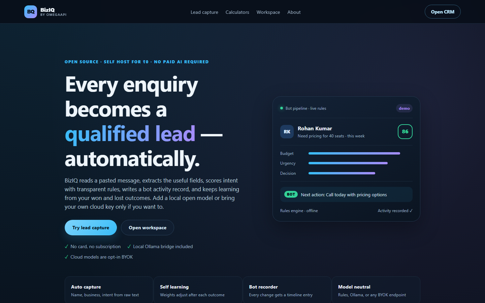
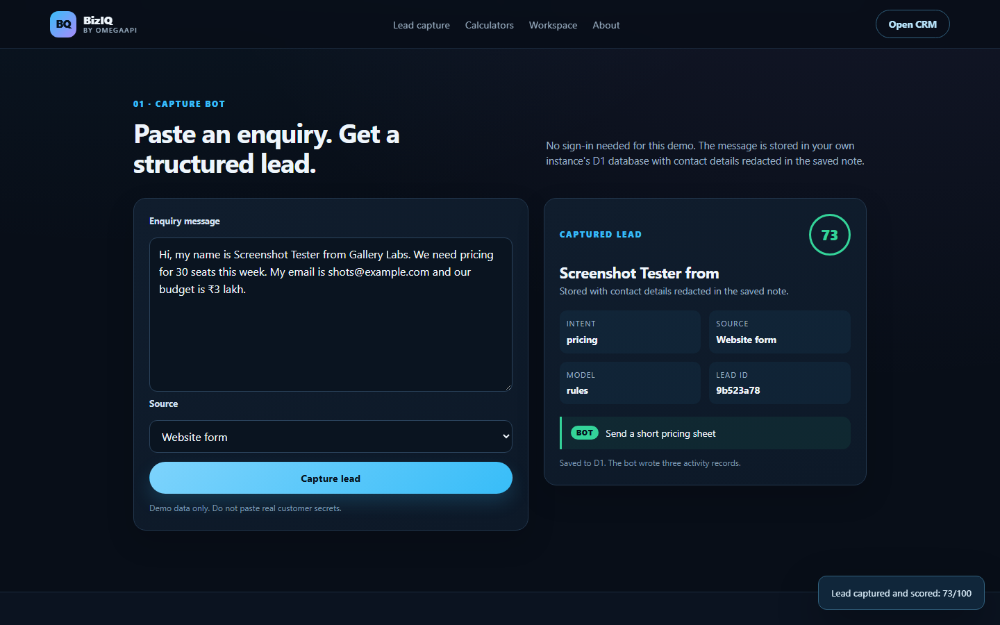
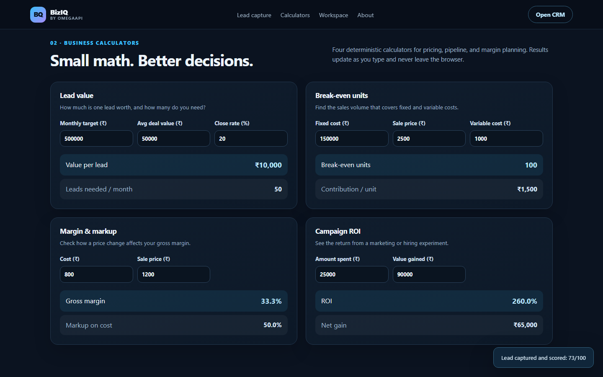
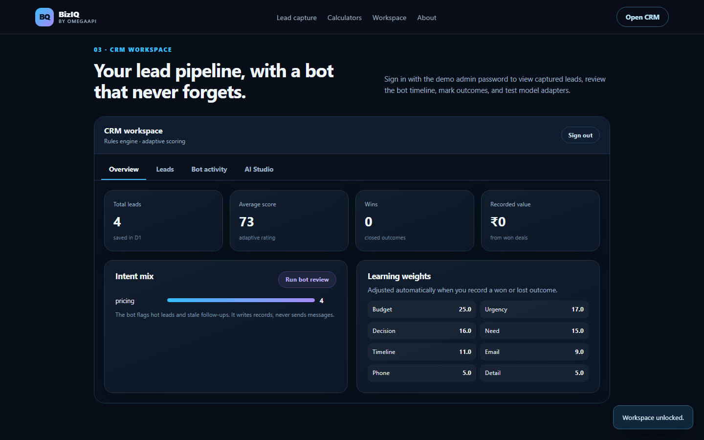
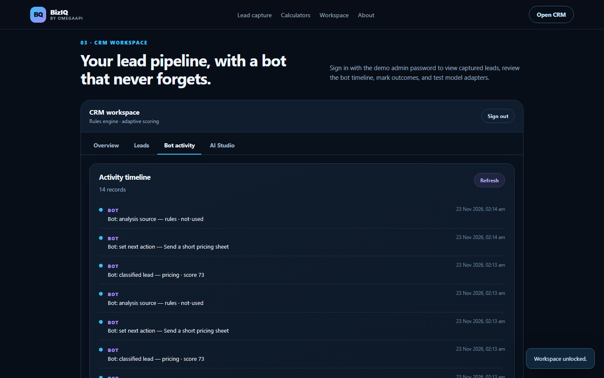
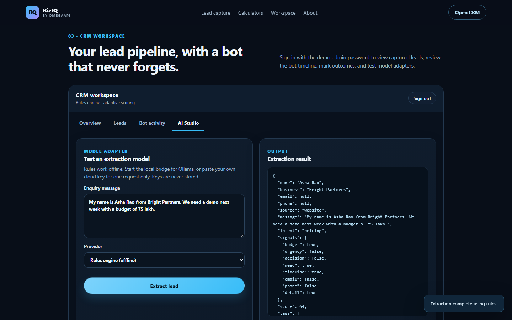

# BizIQ — AI Lead CRM

[](https://biziq.pages.dev/)
[](LICENSE)

BizIQ is an open-source lead CRM demo that turns a plain enquiry message into a structured, scored lead. It includes a self-learning scoring loop, a bot that records every meaningful change, four business calculators, a localhost-only open-model bridge, and an optional bring-your-own-key cloud adapter.

Built by **Krishna Prakash Ojha (Leon)** at **OmegaAPI** · [omegaapi.com](https://omegaapi.com)

> Free preview: the public deployment issues a signed 3-day cookie. No card, payment, or subscription code is included.

---

## What it does

| Area | Feature |
| --- | --- |
| Lead capture | Paste an enquiry. BizIQ extracts name, business, email, phone, source, intent, tags, score, and a suggested next action. |
| Adaptive scoring | Transparent weights stored in D1. Marking a lead won or lost adjusts the weights for future scoring. |
| Bot recorder | Every capture, update, outcome, and pipeline review writes a short activity record. |
| Pipeline review | One button flags high-score leads and stale follow-ups. The bot records work; it never sends messages. |
| Calculators | Lead value, break-even units, margin/markup, and campaign ROI. Browser-only math. |
| Model neutral | Rules engine works offline. Add Ollama locally or any OpenAI-compatible cloud endpoint with your own key. |
| Backend | Cloudflare Pages Functions + D1. Admin workspaces use signed, HttpOnly, 7-day sessions. |
| Privacy | Saved enquiry text is redacted for email and phone. Model keys, admin passwords, and session secrets are never stored in source or D1. |

---

## Live demo

**https://biziq.pages.dev/**

The public preview is protected by a signed three-day cookie. It stores only a timestamp and a random nonce — no name, email, phone, message, IP address, or lead detail.

The workspace password is provided by the project owner. For your own deployment, set `ADMIN_PASSWORD_SECRET` as described below.

---

## Screenshots

| Home | Lead capture |
| --- | --- |
|  |  |

| Calculators | CRM workspace |
| --- | --- |
|  |  |

| Bot activity | AI Studio |
| --- | --- |
|  |  |

---

## How lead capture works

1. The browser posts the message to `POST /api/capture` with a hidden spam field and a form-start timestamp.
2. The server loads the current scoring weights from D1.
3. Optional model refinement runs first when a model adapter is selected.
4. Deterministic extraction builds the lead record. Email and phone are redacted in the stored message note.
5. The lead, a model-run record, and three bot activity entries are written to D1.
6. An outcome (`won` or `lost`) updates the adaptive weights and writes learning records.

Scoring is explainable: every signal — budget, urgency, decision role, need, timeline, email, phone, detail — contributes a visible weight between 4 and 30.

---

## Model adapters

No model is required. The default rules engine runs entirely on the server.

### 1. Rules engine (default)

Deterministic and offline. Best for the public demo and for privacy-sensitive use.

### 2. Local open model

Run any Ollama-compatible local model through the included bridge:

```bash
ollama pull llama3.2
npm run bridge
```

The bridge listens only on `http://127.0.0.1:8789` and forwards a redacted prompt to `http://127.0.0.1:11434`. It stores nothing. The public page is allowed to call only this loopback port through a strict Content Security Policy.

### 3. Cloud model (BYOK)

In **AI Studio → Cloud model (BYOK)**, enter:

- an HTTPS OpenAI-compatible endpoint, such as `https://api.example.com/v1`
- a model name
- your own API key

The key is used for that single request and is never written to D1, logs, source files, or browser storage. Private hosts, localhost URLs, and credentials embedded in the endpoint URL are rejected by validation.

See [docs/MODELS.md](docs/MODELS.md) for details.

---

## Business calculators

All four calculators are client-side and deterministic:

- **Lead value** — value per lead and how many leads are needed for a monthly target.
- **Break-even units** — fixed cost divided by contribution per unit.
- **Margin & markup** — gross margin and markup on cost.
- **Campaign ROI** — percentage return and net gain.

---

## Project structure

```text
assets/                  Browser UI and styles
bridge/                  Localhost-only Ollama bridge
functions/
  _middleware.js         Signed 3-day preview lock
  api/
    admin/               Login, logout, session check
    ai/extract.js        Model-neutral extraction studio
    bot/run.js           Pipeline review bot
    capture.js           Public lead capture
    leads/               List, detail, update
    activities.js        Bot activity timeline
    outcomes.js          Won/lost learning loop
    stats.js             Dashboard totals and weights
    health.js            Public service metadata
lib/                     Extraction, learning, model, auth, event helpers
migrations/              D1 schema
docs/                    Deployment, models, API notes
screenshots/             Demo screenshots
tests/                   Node test suite
```

---

## Run locally

Requirements: Node.js 20+ and Wrangler 4.

```bash
npm install
cp .dev.vars.example .dev.vars
# Fill the three values in .dev.vars with long random strings.
wrangler d1 execute biziq-crm --local --file=migrations/0001_init.sql
wrangler d1 execute biziq-crm --local --file=migrations/0002_lead_note.sql
npm test
npm run dev
```

Open `http://localhost:8790`.

To use the local model bridge in another terminal:

```bash
npm run bridge
```

---

## Deploy your own

1. Create a D1 database and copy its ID into `wrangler.jsonc`.
2. Create a Pages project named `biziq` (or change the project name in `package.json`).
3. Apply both migrations to the remote database.
4. Upload three secrets:

```bash
wrangler pages secret put DEMO_TRIAL_SECRET --project-name biziq
wrangler pages secret put ADMIN_SESSION_SECRET --project-name biziq
wrangler pages secret put ADMIN_PASSWORD_SECRET --project-name biziq
npm run deploy
```

`ADMIN_PASSWORD_SECRET` is the demo workspace password. Keep it outside the repository. Full steps are in [docs/DEPLOYMENT.md](docs/DEPLOYMENT.md).

---

## API overview

| Method | Path | Access | Purpose |
| --- | --- | --- | --- |
| POST | `/api/capture` | Public | Capture and score one lead |
| GET | `/api/health` | Public | Service metadata |
| POST | `/api/admin/login` | Public | Verify demo password, set signed cookie |
| POST | `/api/admin/logout` | Signed in | Clear admin cookie |
| GET | `/api/admin/me` | Public | Session status |
| GET | `/api/leads` | Admin | List or search leads |
| GET/PATCH/DELETE | `/api/leads/:id` | Admin | Read, update, or remove one lead |
| GET | `/api/activities` | Admin | Activity timeline |
| POST | `/api/outcomes` | Admin | Record won/lost and update weights |
| POST | `/api/bot/run` | Admin | Run pipeline review |
| GET | `/api/stats` | Admin | Dashboard totals |
| POST | `/api/ai/extract` | Admin | Model-neutral extraction test |

See [docs/API.md](docs/API.md) for request and response shapes.

---

## Privacy and safety

- No payment, card, or subscription code.
- No developer phone number or third-party chat button in the app.
- Support is limited to a star, a short note, and the project Telegram channel.
- Lead messages are stored with email and phone redacted in the saved note.
- Cloud keys are request-only. Model endpoints must be public HTTPS hosts.
- The preview cookie and admin cookie are signed, HttpOnly, SameSite=Lax, and Secure on HTTPS.
- API responses are marked `no-store`, and a strict CSP blocks unapproved origins.

For production use, add your own retention policy, access controls, and data-handling review before collecting real customer information.

---

## Tests

```bash
npm test
```

33 tests cover extraction, redaction, adaptive weights, model validation, signed sessions, and the trial token.

---

## Support

- Star the repository if it helped.
- Sponsor OmegaAPI through the official GitHub Sponsors page.
- Send a short note to [info@omegaapi.com](mailto:info@omegaapi.com).
- Message the project channel at [Telegram](https://t.me/Omegaapiofficial).

Contact is limited to those two channels. No personal phone number or chat handle is published.

---

## ❤️ Sponsor this project

If BizIQ helps you qualify enquiries or demonstrate a working CRM, please consider sponsoring OmegaAPI. It keeps the live demo online and lets me keep building free, open-source tools.

[](https://github.com/sponsors/omegaapi-india)

Goal: **10 monthly sponsors**. [View monthly tiers ($5, $25, $100, $250)](https://github.com/sponsors/omegaapi-india?interval=monthly). Every monthly sponsor helps. Can't sponsor? A ⭐ on this repo or sharing it with someone who needs it helps too!

---

## License

MIT © 2026 Krishna Prakash Ojha (Leon), OmegaAPI.
